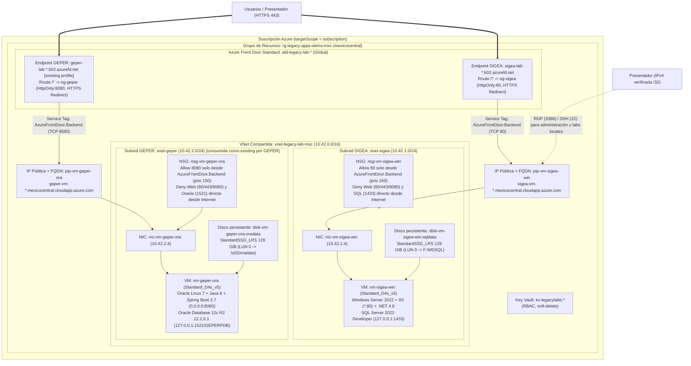

# Infraestructura Azure (Bicep) — SIGEA e Infraestructura Compartida del Laboratorio

> **Laboratorio ficticio de demostración.** Institución ficticia: **Instituto Superior Valle Claro** (SIGEA) y **Corporación Regional Monte Azul** (GEPER). Este directorio define la infraestructura como código (IaC) en **Bicep** para ejecutar el estado *legacy* en **Azure Mexico Central (`mexicocentral`)** como punto de partida previo a ejercicios de modernización agéntica, migración de bases de datos, remediación de vulnerabilidades y preparación para IA.

---

## 1. Arquitectura y relación entre recursos

Este repositorio (`legacy-academic-portal-dotnet`) es el **propietario de la infraestructura compartida** del laboratorio (grupo de recursos, red virtual con subredes para ambos portales y almacén de secretos opcional) además de los recursos específicos de **SIGEA**. El repositorio hermano (`legacy-hr-portal-java`) despliega sus recursos de **GEPER** referenciando el grupo de recursos (`rg-legacy-apps-demo-mxc`) y la subred (`snet-geper`) como recursos `existing`.



---

## 2. Módulos Bicep, recursos y parámetros principales

### 2.1 Tabla de módulos y responsabilidad

| Archivo / Módulo | Alcance (`targetScope`) | Responsabilidad y recursos administrados |
|---|---|---|
| [`main.bicep`](./main.bicep) | `subscription` | Punto de entrada principal. Crea el grupo de recursos `rg-legacy-apps-demo-mxc` en `mexicocentral` e invoca los módulos de red, Key Vault y cómputo de SIGEA. |
| [`modules/network.bicep`](./modules/network.bicep) | `resourceGroup` | Crea la VNet compartida `vnet-legacy-lab-mxc` (`10.42.0.0/16`), las subredes `snet-sigea` (`10.42.1.0/24`) y `snet-geper` (`10.42.2.0/24`), y el `nsg-vm-sigea-win` sin reglas abiertas a `0.0.0.0/0` y con bloqueo explícito de puertos web/SQL desde Internet. |
| [`modules/keyvault.bicep`](./modules/keyvault.bicep) | `resourceGroup` | Crea un Azure Key Vault opcional (`kv-legacylabb-*`) con autorización RBAC y *soft-delete* para resguardo opcional de secretos de operación. |
| [`modules/sigea-vm.bicep`](./modules/sigea-vm.bicep) | `resourceGroup` | Crea la IP pública estática con etiqueta DNS (`pip-vm-sigea-win`, `sigea-vm-*.mexicocentral.cloudapp.azure.com`), la interfaz de red (`nic-vm-sigea-win`), el disco administrado persistente para SQL Server (`disk-vm-sigea-win-sqldata`, LUN 0, `deleteOption: 'Detach'`) y la máquina virtual `vm-sigea-win` con identidad administrada `SystemAssigned`. |
| [`modules/frontdoor.bicep`](./modules/frontdoor.bicep) | `resourceGroup` | Crea el perfil compartido de **Azure Front Door Standard** (`Microsoft.Cdn/profiles@2024-02-01`, `afd-legacy-lab-*`), el endpoint HTTPS de SIGEA (`sigea-lab-*`), el grupo de origen `og-sigea` con afinidad de sesión y sondas de salud `GET /`, el origen `origin-sigea-vm` (puerto 80) y la ruta `route-sigea-default` con redirección automática HTTP -> HTTPS. |
| [`main.bicepparam`](./main.bicepparam) | `subscription` | Archivo de parámetros de ejemplo sin secretos ni IPs privadas; lee `SIGEA_VM_ADMIN_PASSWORD` desde variable de entorno. |

### 2.2 Parámetros principales de `main.bicep`

| Parámetro | Tipo | Valor predeterminado | Descripción |
|---|---|---|---|
| `location` | `string` | `'mexicocentral'` | Región Azure fija y restringida (`@allowed(['mexicocentral'])`). |
| `resourceGroupName` | `string` | `'rg-legacy-apps-demo-mxc'` | Grupo de recursos compartido del laboratorio. |
| `vnetName` | `string` | `'vnet-legacy-lab-mxc'` | Nombre de la VNet compartida entre SIGEA y GEPER. |
| `vnetAddressPrefix` | `string` | `'10.42.0.0/16'` | Espacio de direcciones CIDR de la VNet. |
| `sigeaSubnetName` | `string` | `'snet-sigea'` | Nombre de la subred dedicada a SIGEA (`10.42.1.0/24`). |
| `geperSubnetName` | `string` | `'snet-geper'` | Nombre de la subred dedicada a GEPER (`10.42.2.0/24`), consumida como `existing` por el repositorio Java. |
| `presenterAllowedCidr` | `string` | `''` | Prefijo IPv4 `/32` verificado del presentador para RDP (puerto 3389). Si es vacío `''`, no se crea regla `Allow` de entrada RDP desde Internet. Rechaza `0.0.0.0/0`, `*` e `Internet`. |
| `enablePublicIp` | `bool` | `true` | Crea o no la IP pública estática Standard de administración. |
| `sigeaVmName` | `string` | `'vm-sigea-win'` | Nombre de la VM de SIGEA. |
| `sigeaVmSize` | `string` | `'Standard_D4s_v5'` | Tamaño de VM (4 vCPU, 16 GiB RAM). |
| `sigeaImagePublisher` | `string` | `'MicrosoftSQLServer'` | Publisher de la imagen de Windows Server + SQL Server. |
| `sigeaImageOffer` | `string` | `'sql2022-ws2022'` | Offer de Windows Server 2022 con SQL Server 2022. |
| `sigeaImageSku` | `string` | `'sqldev-gen2'` | SKU Developer Edition Gen2 (exclusivo para desarrollo/demostración). |
| `sigeaImageVersion` | `string` | `'16.0.260610'` | Versión exacta registrada de la imagen en `mexicocentral`. |
| `osDiskSku` / `dataDiskSku` | `string` | `'StandardSSD_LRS'` | Tipo de disco administrado (`StandardSSD_LRS` o `Premium_LRS`). |
| `osDiskSizeGb` / `dataDiskSizeGb` | `int` | `128` | Tamaño en GiB de los discos de SO y de datos SQL. |
| `adminUsername` | `string` | `'sigeaadmin'` | Usuario administrador local de Windows. |
| `adminPassword` | `string` (`@secure()`) | *(requerido)* | Contraseña del administrador local; nunca se expone en outputs. |
| `enableKeyVault` | `bool` | `true` | Despliega el Key Vault compartido del laboratorio. |
| `enableFrontDoor` | `bool` | `true` | Despliega el perfil compartido de Azure Front Door Standard, el endpoint HTTPS de SIGEA y la regla NSG `Allow-AzureFrontDoor-HTTP-Inbound` (Service Tag `AzureFrontDoor.Backend`). |
| `frontDoorProfileName` | `string` | `''` | Nombre personalizado opcional para el perfil de Azure Front Door (vacío genera `afd-legacy-lab-<hash>`). |
| `sigeaFrontDoorEndpointName` | `string` | `''` | Nombre personalizado opcional para el endpoint de SIGEA (vacío genera `sigea-lab-<hash>`). |
| `tags` | `object` | `{ project: 'legacy-modernization-lab', ... }` | Etiquetas aplicadas a todos los recursos. |

---

## 3. Prerrequisitos, permisos, cuotas y región `mexicocentral`

- **Herramientas en la estación de trabajo:** Azure CLI (`az >= 2.60`) con extensión `bicep` y `quota`, PowerShell 7+ o Windows PowerShell 5.1, y cliente RDP (`mstsc`) / SSH.
- **Permisos Azure requeridos:** Rol `Contributor` (o `Owner` si se asignan roles RBAC adicionales sobre Key Vault) en la suscripción seleccionada.
- **Verificación de cuotas en `mexicocentral`:**
  ```powershell
  az extension add --name quota --upgrade
  az quota list --scope "/subscriptions/<SUBSCRIPTION_ID>/providers/Microsoft.Compute/locations/mexicocentral" -o table
  az rest --method get --url "https://management.azure.com/subscriptions/<SUBSCRIPTION_ID>/providers/Microsoft.Compute/skus?api-version=2021-07-01&`$filter=location eq 'mexicocentral'" --query "value[?resourceType=='virtualMachines' && name=='Standard_D4s_v5'].{Name:name, Restrictions:restrictions}" -o json
  ```
  El laboratorio utiliza 8 vCPU en total (`2 × Standard_D4s_v5`: 4 vCPU para SIGEA y 4 vCPU para GEPER) dentro de la familia `standardDSv5Family`.

---

## 4. Dependencias entre repositorios y orden de despliegue

1. **Primero — `legacy-academic-portal-dotnet/infra/azure/` (este repositorio):**
   Crea el grupo de recursos `rg-legacy-apps-demo-mxc`, la VNet compartida `vnet-legacy-lab-mxc` (con las subredes `snet-sigea` y `snet-geper`), el Key Vault y la VM `vm-sigea-win`.
2. **Segundo — `legacy-hr-portal-java/infra/azure/`:**
   Recibe los parámetros `existingResourceGroupName = 'rg-legacy-apps-demo-mxc'`, `existingVnetName = 'vnet-legacy-lab-mxc'` y `existingSubnetName = 'snet-geper'`, referenciándolos como recursos `existing` sin duplicar la administración del grupo de recursos ni de la red virtual.

| Output de `legacy-academic-portal-dotnet` | Parámetro de entrada en `legacy-hr-portal-java` | Valor por defecto conectado |
|---|---|---|
| `resourceGroupName` | `existingResourceGroupName` | `rg-legacy-apps-demo-mxc` |
| `vnetName` | `existingVnetName` | `vnet-legacy-lab-mxc` |
| `geperSubnetName` | `existingSubnetName` | `snet-geper` |
| `frontDoorProfileName` | `existingFrontDoorProfileName` | `afd-legacy-lab-<hash>` (calculado con el mismo `uniqueString(rg.id)`) |

---

## 5. Gestión de secretos

- **Ningún secreto se almacena en Git.** Los archivos versionados (`main.bicepparam`, `src/SIGEA.Web/Web.config`, `config/Web.config.example`) contienen únicamente placeholders o lecturas desde variables de entorno (`readEnvironmentVariable('SIGEA_VM_ADMIN_PASSWORD', '')`).
- **Dentro de `vm-sigea-win`:** El script [`scripts/bootstrap-vm-sigea.ps1`](./scripts/bootstrap-vm-sigea.ps1) genera contraseñas aleatorias únicas para los logins SQL de mínimo privilegio (`sigea_app` y `sigea_labro`), las guarda exclusivamente en `C:\SIGEA\Secrets\sql-credentials.json` (con permisos NTFS restringidos a `BUILTIN\Administrators` y `NT AUTHORITY\SYSTEM`), y realiza una transformación XML explícita sobre `C:\inetpub\sigea\Web.config` reemplazando `${SIGEA_APP_PASSWORD}` y `${SIGEA_LAB_PASSWORD}` sin imprimir secretos en consola ni en logs de extensión.

---

## 6. Comandos exactos para compilar, validar, ejecutar `what-if` y desplegar

```powershell
# 1. Seleccionar explícitamente la suscripción autorizada
az account set --subscription "<SUBSCRIPTION_ID>"

# 2. Definir la contraseña del administrador de la VM en variable de entorno (sin pasarla en línea de comandos)
$env:SIGEA_VM_ADMIN_PASSWORD = "<PASSWORD_ROBUSTA_GENERADA>"

# 3. Compilar Bicep y validar parámetros (linter/compilador)
az bicep build --file infra/azure/main.bicep --stdout | Out-Null
az bicep build-params --file infra/azure/main.bicepparam --stdout | Out-Null

# 4. Validación ARM a nivel de suscripción
az deployment sub validate `
  --location mexicocentral `
  --name validate-sigea-shared-mxc `
  --parameters infra/azure/main.bicepparam `
  --parameters presenterAllowedCidr="<IP_PUBLICA_PRESENTADOR>/32"

# 5. Análisis preliminar con what-if (Nota: what-if valida el grafo ARM pero no garantiza capacidad física ni éxito de scripts invitados)
az deployment sub what-if `
  --location mexicocentral `
  --name whatif-sigea-shared-mxc `
  --parameters infra/azure/main.bicepparam `
  --parameters presenterAllowedCidr="<IP_PUBLICA_PRESENTADOR>/32"

# 6. Ejecutar el despliegue autorizado
az deployment sub create `
  --location mexicocentral `
  --name deploy-sigea-shared-mxc `
  --parameters infra/azure/main.bicepparam `
  --parameters presenterAllowedCidr="<IP_PUBLICA_PRESENTADOR>/32"
```

También puede utilizar el script envolvente documentado:

```powershell
./infra/azure/scripts/manage-lab.ps1 -Action Validate -SubscriptionId "<SUBSCRIPTION_ID>"
./infra/azure/scripts/manage-lab.ps1 -Action Deploy   -SubscriptionId "<SUBSCRIPTION_ID>" -PresenterAllowedCidr "<IP_PUBLICA_PRESENTADOR>/32"
```

---

## 7. Configuración del sistema operativo, SQL Server e IIS

El script [`scripts/bootstrap-vm-sigea.ps1`](./scripts/bootstrap-vm-sigea.ps1) configura la VM Windows Server 2022 de forma repetible:

1. **Disco de datos persistente (`LUN 0` -> `F:\`):** Si el disco administrado `disk-vm-sigea-win-sqldata` está sin inicializar (`RAW`), lo inicializa en GPT y lo formatea como `F:\` (`SQLDATA`), creando `F:\MSSQL\Data`, `F:\MSSQL\Log` y `F:\MSSQL\Backup` con ACL para `NT Service\MSSQLSERVER`.
2. **SQL Server 2022 Developer Edition:** Configura el servicio `MSSQLSERVER` en inicio automático (`Automatic`), habilita modo mixto (`LoginMode = 2`), apunta los directorios por defecto a `F:\MSSQL` y bloquea el puerto `1433` entrante en el Firewall de Windows para que solo acepte conexiones por *loopback* (`127.0.0.1` / `localhost`).
3. **Cuentas de mínimo privilegio:** Crea la base `SIGEA` en `F:\MSSQL\Data\SIGEA.mdf`, el login/usuario `sigea_app` (`SELECT, INSERT, UPDATE, DELETE` en `SCHEMA::dbo`) y el login/usuario `sigea_labro` (`SELECT` únicamente sobre `dbo.Person`, `dbo.Enrollment` y `dbo.Course`). La aplicación nunca se ejecuta como `sa`.
4. **IIS y ASP.NET 4.8:** Instala los roles de IIS y ASP.NET 4.8, configura el servicio `W3SVC` en inicio automático, crea el Application Pool `SigeaAppPool` con identidad de mínimo privilegio `ApplicationPoolIdentity`, publica la aplicación en `C:\inetpub\sigea` enlazada exclusivamente a `127.0.0.1:80`, deshabilita `debug="false"` y mantiene `ENABLE_VULNERABILITY_LABS="false"`.

### Cambios realizados en el código de SIGEA para compilación y pruebas en Windows

| Archivo | Cambio realizado | Motivo |
|---|---|---|
| `src/SIGEA.Web/SIGEA.Web.csproj` | Adición de `<Reference Include="Microsoft.CSharp" />` | Requerido por el compilador C# en .NET Framework 4.8 al emplear `ViewBag` (`dynamic`) en los controladores MVC 5 (`CS0656`). |
| `src/SIGEA.Web/Web.config` | Adición de `bindingRedirect` para `Antlr3.Runtime` (`3.5.0.2`) y `WebGrease` (`1.6.5135.21930`), y `<globalization fileEncoding="utf-8" requestEncoding="utf-8" responseEncoding="utf-8" />` | Elimina advertencias `MSB3247` en MSBuild 17 y asegura que IIS en Windows Server 2022 interprete en UTF-8 las vistas Razor `.cshtml` sin BOM. |
| `src/SIGEA.Web/DAL/SchoolContext.cs` | Resolución de `SIGEA_APP_PASSWORD` desde variable de entorno cuando la cadena contiene placeholder o contraseña vacía en ejecuciones de prueba locales | Permite ejecutar `IntegrationTests` contra SQL Server local en la VM mediante variables de entorno sin escribir secretos en `SIGEA.Tests.dll.config`. |
| `src/SIGEA.Tests/SIGEA.Tests.csproj`, `packages.config`, `app.config` | Referencias a `System.Web.Mvc`, `EntityFramework`, `xunit.execution.desktop`, `System.Threading.Tasks.Extensions` y `bindingRedirect` de `xunit.core` / `Validation` | Requeridos para compilar `SIGEA.Tests` y descubrir los 10 tests (incluidos `[SkippableFact]` y mocks con `Moq`) en `vstest.console.exe`. |
| `src/SIGEA.Tests/LabGateTests.cs`, `LabOnlyAttributeTests.cs` | Atributo `[Collection("LabGateConfig")]` | Evita condición de carrera cuando xUnit ejecuta en paralelo dos clases que mutan `ConfigurationManager.AppSettings["ENABLE_VULNERABILITY_LABS"]`. |

---

## 8. Publicación en Azure Front Door, acceso del presentador y laboratorios de seguridad

- **Acceso público HTTPS mediante Azure Front Door Standard:**
  - La aplicación normal de SIGEA se publica en el endpoint HTTPS generado por `frontDoor.outputs.sigeaEndpointUrl` (ej. `https://sigea-lab-<hash>-<hash>.b02.azurefd.net/`).
  - Azure Front Door termina TLS en el borde, redirige automáticamente `http://` -> `https://` (`307 Temporary Redirect`), mantiene afinidad de sesión (`sessionAffinityState: 'Enabled'`) para el estado `InProc` de ASP.NET MVC 5 y reenvía el tráfico hacia el origen `sigea-vm-*.mexicocentral.cloudapp.azure.com:80`.
  - **Protección de origen (sin exposición directa de la VM):** El NSG `nsg-vm-sigea-win` incluye la regla `Allow-AzureFrontDoor-HTTP-Inbound` (prioridad `150`, origen `AzureFrontDoor.Backend`, puerto `80`) seguida de `Deny-Internet-Web-Inbound` (prioridad `200`, origen `Internet`, puertos `80, 443, 8080`). Cualquier intento de conectarse directamente a `http://<IP_PUBLICA_SIGEA>:80` sin pasar por Azure Front Door es bloqueado por el NSG.
  - **Aislamiento estricto de los laboratorios vulnerables (`/Lab`):** Las rutas `/Lab` y `/Lab/Sqli` devuelven **`404 Not Found`** a través de Azure Front Door. Además de desplegarse con `ENABLE_VULNERABILITY_LABS=false`, `LabGate.IsEnabled` comprueba `Request.IsLocal` sobre el socket TCP (sin confiar en `X-Forwarded-For`), por lo que los ejercicios de vulnerabilidades **jamás pueden ser invocados a través de Azure Front Door** incluso cuando el presentador los habilita temporalmente dentro de la VM.
- **Acceso administrativo del presentador (RDP) para los ejercicios de seguridad en localhost:**
  1. Autorice su IPv4 pública `/32` en `presenterAllowedCidr` mediante Bicep (`./infra/azure/scripts/manage-lab.ps1 -Action Deploy -PresenterAllowedCidr "<MI_IP>/32"`).
  2. Conéctese por RDP a `vm-sigea-win` (`mstsc /v:<IP_PUBLICA_SIGEA>`) con el usuario `sigeaadmin`.
  3. Dentro de la VM, abra Microsoft Edge en **`http://localhost/`** (o `http://127.0.0.1/`).
- **Activar temporalmente los laboratorios de seguridad (`DOTNET-SQLI-01` y `DOTNET-IDOR-01`) solo por localhost:**
  Dentro de la VM (PowerShell como Administrador):
  ```powershell
  powershell.exe -ExecutionPolicy Bypass -File C:\SIGEA\stage\scripts\set-lab-mode-sigea.ps1 -Enable $true
  ```
  Navegue dentro de la VM a `http://localhost/Lab` (aparecerá la banda *"Laboratorio vulnerable activo · Datos ficticios"*).
- **Desactivar los laboratorios inmediatamente después del ejercicio:**
  ```powershell
  powershell.exe -ExecutionPolicy Bypass -File C:\SIGEA\stage\scripts\set-lab-mode-sigea.ps1 -Enable $false
  powershell.exe -ExecutionPolicy Bypass -File C:\SIGEA\stage\scripts\reset-dataset-sigea.ps1 -Mode LabOnly
  ```

---

## 9. Redespliegue sin pérdida de datos, actualización, reversión y restablecimiento

- **Redespliegue sin pérdida de datos:**
  - En Bicep, el disco `disk-vm-sigea-win-sqldata` es un recurso administrado independiente con `deleteOption: 'Detach'`.
  - En `bootstrap-vm-sigea.ps1`, si `dbo.Person` ya existe en la base `SIGEA`, el script **conserva intactos los datos y las tablas**, actualizando únicamente los binarios web en `C:\inetpub\sigea` y verificando los permisos de `sigea_app` / `sigea_labro`.
- **Actualización y reversión de la aplicación:**
  Antes de actualizar `C:\inetpub\sigea`, puede respaldar la versión publicada con `Copy-Item C:\inetpub\sigea C:\SIGEA\backup-web -Recurse -Force` y revertir copiando de vuelta y reciclando `SigeaAppPool`.
- **Restablecimiento explícito del dataset sintético (20 estudiantes, 6 instructores, 8 cursos, 4 departamentos, 33 matrículas):**
  ```powershell
  ./infra/azure/scripts/manage-lab.ps1 -Action ResetDataset -SubscriptionId "<SUBSCRIPTION_ID>"
  ```

---

## 10. Inicio, desasignación, eliminación y costos

### 10.1 Operaciones de ciclo de vida

```powershell
# Iniciar la VM antes de una demostración
./infra/azure/scripts/manage-lab.ps1 -Action Start -SubscriptionId "<SUBSCRIPTION_ID>"

# Desasignar la VM al terminar la sesión (detiene el cobro por cómputo)
./infra/azure/scripts/manage-lab.ps1 -Action Deallocate -SubscriptionId "<SUBSCRIPTION_ID>"

# Eliminar exclusivamente el laboratorio completo cuando ya no se necesite
./infra/azure/scripts/manage-lab.ps1 -Action Teardown -SubscriptionId "<SUBSCRIPTION_ID>" -ConfirmTeardown
```

### 10.2 Estimación de costos en `mexicocentral` (precios minoristas Azure, USD, Consumption)

| Recurso | SKU / Configuración | Costo en ejecución (USD) | ¿Sigue facturándose al desasignar (`Deallocate`)? |
|---|---|---|---|
| VM SIGEA (`vm-sigea-win`) | `Standard_D4s_v5` (Windows, 4 vCPU, 16 GiB RAM) | $0.395 / hora (~$288.35 / mes a 730 h) | **No** ($0.00 cómputo al estar `VM deallocated`) |
| VM GEPER (`vm-geper-ora`) | `Standard_D4s_v5` (Linux, 4 vCPU, 16 GiB RAM) | $0.211 / hora (~$154.03 / mes a 730 h) | **No** ($0.00 cómputo al estar `VM deallocated`) |
| Discos de SO y datos (4 × 128 GiB) | `StandardSSD_LRS` (`E10`, 128 GiB c/u: 2 en SIGEA + 2 en GEPER) | ~$11.56 / mes por disco (~$46.24 / mes total) | **Sí** (los discos administrados persisten mientras no se eliminen) |
| IP Públicas Estáticas (2 × Standard) | `Standard` IPv4 Static (`pip-vm-sigea-win`, `pip-vm-geper-ora`) | ~$0.01 / hora c/u (~$7.30 / mes c/u) | **Sí** (las IP estáticas Standard continúan facturando mientras existan) |
| Azure Front Door Standard (compartido) | `Standard_AzureFrontDoor` (`afd-legacy-lab-*` con 2 endpoints: SIGEA y GEPER) | $35.00 / mes base + $0.01 / 10K peticiones | **Sí** (la cuota base mensual del perfil Front Door continúa activa hasta eliminar el perfil) |
| Key Vault + VNet + NSG | Standard Key Vault / Virtual Network | < $0.05 / mes (solo por operaciones KV) | Mínimo (solo operaciones) |

---

## 11. Limitaciones reales y solución de problemas

- **Limitaciones reales del entorno:**
  - **Sin alta disponibilidad ni redundancia zonal/regional:** Cada aplicación corre en una única VM con discos `StandardSSD_LRS` con propósito exclusivo de laboratorio y demostración.
  - **Sin respaldo automático configurado:** La recuperación del estado de demostración se realiza mediante los scripts deterministas de restablecimiento (`reset-dataset-sigea.ps1`).
  - **Licenciamiento de desarrollo:** SQL Server 2022 Developer Edition está licenciado exclusivamente para desarrollo, pruebas y demostración no productiva.
- **Solución de problemas frecuentes:**
  - *Error `SkuNotAvailable` o falta de capacidad en `mexicocentral`:* Verifique restricciones zonales con `az rest` sobre `Microsoft.Compute/skus`; la plantilla no fija zona para permitir a Azure asignar entre las zonas con capacidad disponible en `mexicocentral`, o cambie `sigeaVmSize` a `Standard_D4as_v5` / `Standard_D4s_v4`.
  - *Error `QuotaExceeded`:* Ejecute `az quota list --scope /subscriptions/<SUB>/providers/Microsoft.Compute/locations/mexicocentral -o table` para verificar disponibilidad en `standardDSv5Family` y `cores`.
  - *Bloqueo de conexión RDP:* Confirme que su IPv4 pública actual coincide con `presenterAllowedCidr` (`/32`) en el NSG `nsg-vm-sigea-win`.
